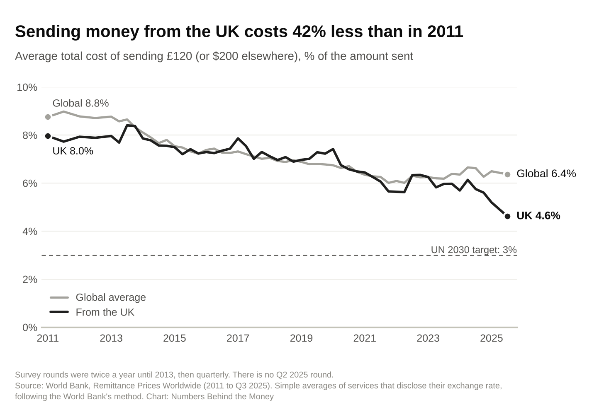
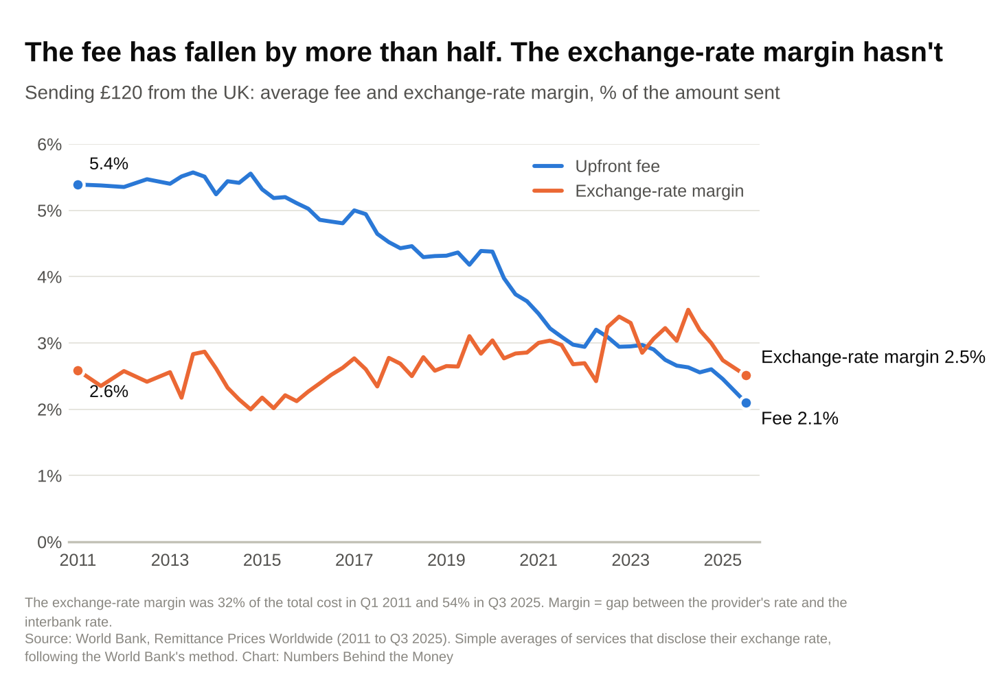
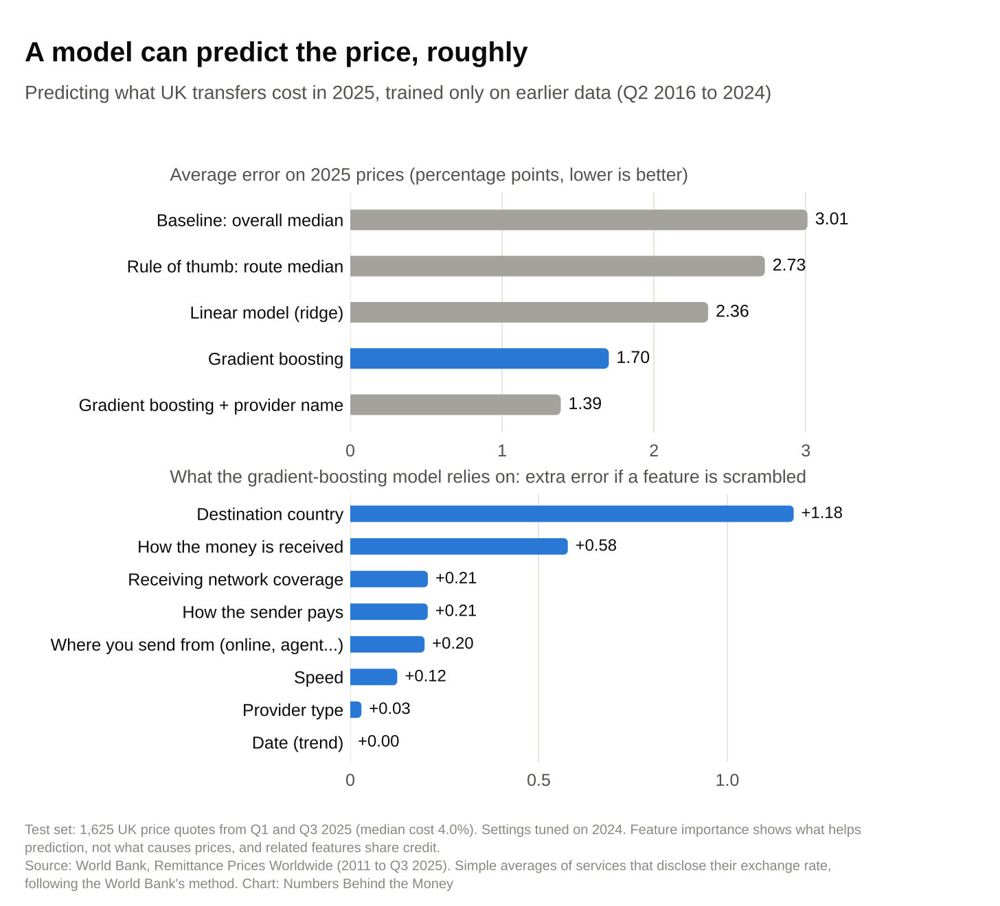

# What it really costs to send money from the UK

Analysis for **Numbers Behind the Money**, a Substack on payments, fintech and crypto through data.

Using the World Bank's *Remittance Prices Worldwide* dataset (Q1 2011 to Q3 2025), this project measures how much it costs to send £120 abroad from the UK, how that has changed, and how much of the cost is hidden in the exchange rate.

## Key findings (Q3 2025 unless stated)

| Finding | Value |
|---|---|
| Average cost of sending £120 from the UK | **4.61%** (£5.54), down from 7.96% in Q1 2011 (−42%) |
| Global average cost of sending $200 | 6.36% (reproduces the World Bank's published figure) |
| Like-for-like check, 26 routes surveyed in both periods | 7.96% → 4.46%; 24 of 26 routes got cheaper |
| Upfront fee vs exchange-rate margin, 2011 → 2025 | fee 5.39% → 2.10%; margin 2.59% → 2.51% |
| Share of the cost hidden in the exchange rate | 32% (2011) → **54%** (2025); about 30% globally |
| UK services charging no fee | 23%; they still cost 2.08% on average, all exchange-rate margin |
| Routes under the UN's 3% target / over 5% | 5 / 14 of 33 (none were under 3% in 2011) |
| Cheapest / most expensive route | India 1.9% / The Gambia 12.1% |
| Online → bank account vs cash at an agent → cash pickup | 2.8% vs 11.5% |
| Typical gap between the cheapest and dearest service on one route | 13 percentage points (about £15.70 on £120) |
| Predicting 2025 prices (trained on Q2 2016–2024), mean absolute error | median guess 3.01 · route median 2.73 · ridge 2.36 · **gradient boosting 1.70** · + provider name 1.39 percentage points |
| What the model relies on most | destination, then how the money is received |

## Method

- **Total cost** = upfront fee + exchange-rate margin, as a % of the amount sent (the margin is the gap between the provider's rate and the interbank rate).
- **Averages** are simple averages across services, excluding services that don't disclose their exchange rate, following the World Bank's method. The code reproduces the published global average for Q3 2025 (6.36%) as a check.
- The UK amounts are £120 and £300 (the World Bank's equivalents of $200 and $500); £120 is used unless stated.

## Files

| File | What it does |
|---|---|
| `uk_remittance_costs.ipynb` | The analysis, step by step, with outputs |
| `rpw.py` | Loading, cleaning and the summary calculations |
| `ml.py` | The prediction models: baselines, ridge regression and gradient boosting, with a time-ordered test |
| `charts.py` | The six publication charts (matplotlib + seaborn) |
| `charts/` | Chart images used in the post |

## Run it

1. Download `rpw_dataset_2011_2025_q3.xlsx` from the [World Bank Data Catalog](https://datacatalog.worldbank.org/search/dataset/0037898/remittance-prices-worldwide) into `data/`.
2. `pip install -r requirements.txt`
3. Open `uk_remittance_costs.ipynb` and run all cells. The first load takes about a minute.

## Machine learning

Target: total cost of sending £120 (%), one row per service quote. Features: destination, provider type, payment instrument, access point, pickup method, speed, receiving network coverage and date (the service fields begin in Q2 2016). Evaluation is time-ordered to avoid leakage between similar quotes: train Q2 2016–2023, tune on 2024, then refit and score once on 2025 (1,625 quotes). Interpretation uses permutation importance on the 2025 test set. Importance shows what helps prediction, not what causes prices.

## Limitations

Prices are one-day snapshots per survey round; simple averages ignore market share (the data has no volumes); margins are measured against an interbank rate, which can mislead where official and market exchange rates differ; the set of UK routes grew from 26 to 33 (controlled for with the like-for-like check); there is no Q2 2025 round; the UK sample has only about 20 bank services, mostly banks from receiving countries.

## Data and licence

Data: The World Bank, Remittance Prices Worldwide, [remittanceprices.worldbank.org](https://remittanceprices.worldbank.org) (listed as CC BY 4.0 in the World Bank Data Catalog). The raw dataset is not included in this repository. This analysis is not endorsed by the World Bank.

This is analysis of public data, not financial advice.
